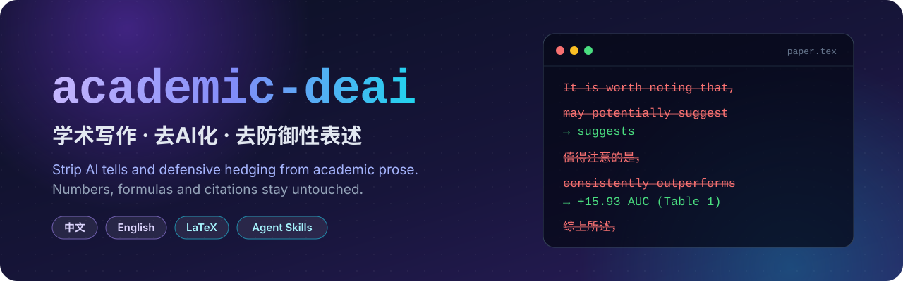
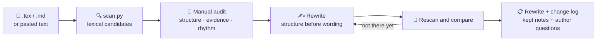

<div align="center">



<br/>

[简体中文](README.md) · **English**

[](LICENSE)
[](https://agentskills.io)
[](skills/academic-deai/scripts/scan.py)
[](#-rule-catalogs)


[Quick start](#-quick-start) · [Demo](#-demo) · [How it works](#%EF%B8%8F-how-it-works) · [Rule catalogs](#-rule-catalogs) · [Scanner](#-scanner)

</div>

---

> Remove *It is worth noting that*, *In conclusion*, *may potentially* and other AI tells and self-protective hedges, while **keeping** the caution your evidence actually calls for.
> Numbers, formulas, citation keys and terminology are never touched.

## ✨ Features

<table>
<tr>
<td width="50%" valign="top">

### 🧹 Strip AI tells
Formulaic openers and closers, boilerplate emphasis, significance hype, light verbs, negative parallelism, *delve / underscore / pivotal*, em-dashes, uniform sentence rhythm. Chinese patterns too: 值得注意的是, 综上所述, 四字格堆砌.

</td>
<td width="50%" valign="top">

### 🛡️ Remove defensive hedging
Stacked hedges (*may potentially*), pre-emptive self-defence (*We do not claim that…*), generic *further research is needed*, concessive boilerplate, excessive modesty, repeated scope disclaimers.

</td>
</tr>
<tr>
<td valign="top">

### ⚖️ No over-correction
Correlation vs. causation, genuine mechanistic speculation, confidence intervals and p-values, and the limitations section are kept. Turning *suggests* into *proves* is manufacturing an over-claim, and the rules forbid it.

</td>
<td valign="top">

### 🔒 Hard constraints
Never changes numbers, formulas, `\cite` / `\ref` / `\label` or LaTeX structure; adds no facts; drops no argument. When a claim lacks a number, it is flagged for the author instead of invented.

</td>
</tr>
<tr>
<td valign="top">

### 🔍 Zero-dependency scanner
`scan.py` uses only the Python standard library, runs Chinese and English rules together, skips LaTeX comments, math and citation keys, and reports line-numbered candidates plus sentence-rhythm statistics.

</td>
<td valign="top">

### 🔌 One skill, many agents
Follows the open [Agent Skills](https://agentskills.io) standard. Install through the Claude Code plugin marketplace, `npx skills`, or the bundled install scripts.

</td>
</tr>
</table>

## 🎬 Demo

A real paragraph from the analysis section of a LaTeX paper, processed in the skill's `rewrite` mode.

```diff
- We compare the best single layer, selected by global validation and read with its per-layer linear probe, against this temporal oracle on the UCF-Crime and XD-Violence datasets.
- All numbers in this analysis are measured with the per-layer probe, which is the diagnostic protocol of this section; the deployed pipeline studied in Section~\ref{sec:experiments} reads the same layers through the temporal scorer and therefore yields different absolute values.
- As shown in Table~\ref{tab:preliminary_gap}, the temporal oracle consistently outperforms the static best layer, with a notable improvement on XD-Violence.
- This gap indicates that static single-layer selection may leave substantial headroom when temporal variation in layer preference is not considered.
- In other words, the performance gap suggests that the limitation lies in the static reading strategy, rather than in the absence of useful anomaly-related features within the model.
+ We compare the best single layer, selected by global validation, against the temporal oracle on UCF-Crime and XD-Violence, reading both through the same per-layer linear probes.
+ These probe-based numbers are diagnostic; the deployed pipeline in Section~\ref{sec:experiments} reads the same layers through the temporal scorer, so its absolute values differ.
+ As shown in Table~\ref{tab:preliminary_gap}, the oracle exceeds the static best layer by 15.93 AUC on UCF-Crime and 23.66 AP on XD-Violence.
+ Both read the same frozen features.
+ The gap therefore suggests that the bottleneck is the static reading strategy, not a lack of anomaly-relevant features in the model.
```

| Metric | Before | After |
|---|:---:|:---:|
| Words | 133 | **97** (−27%) |
| Hedges | indicates + may + suggests | **suggests** |
| Intensifiers without a number | consistently · notable · substantial | **0** |
| Sentences over 30 words | 1 | **0** |
| Sentence-length CV (lower = more uniform) | 0.27 | **0.36** |
| `\ref` keys | 2 | **2** (unchanged) |

<details>
<summary><b>📋 Change log: what changed and why</b></summary>

<br/>

| # | Type | Change | Reason |
|---|---|---|---|
| 1 | Intensifier without a number | *consistently outperforms … notable improvement* → *exceeds … by 15.93 AUC and 23.66 AP* | The gaps are already in the paper's table |
| 2 | Stacked hedge | Deleted *indicates that … may leave substantial headroom* | The upper bound is measured, so *may* and *substantial* add nothing; the sentence repeats the previous one |
| 3 | Restatement | *In other words, …* → *… therefore …* | Rephrasing adds no information; *therefore* states the actual inference |
| 4 | Missing premise | Added *Both read the same frozen features.* | The inference relied on an unstated premise; as a short sentence it also varies the rhythm |
| 5 | Redundancy | Protocol note cut from 39 to 27 words | All information kept |

**Kept on purpose**

- ***suggests***: the oracle picks the best layer per frame using ground-truth labels, so the bound is optimistic. "The bottleneck is the reading strategy" is an inference, not a measurement, and the verb should stay at *suggests*.
- ***not a lack of …***: "the features themselves are weak" is the alternative a reviewer will raise, and the previous sentence gives the grounds for ruling it out, so the contrast does real work.

**Flagged for the author**

- The same protocol note appears again in the experiments section; keeping one is enough.

</details>

## 🚀 Quick start

### Option 1: Claude Code plugin marketplace

```bash
claude plugin marketplace add LinYeeGiong/academic-deai
claude plugin install academic-deai@academic-deai
```

> Inside a session, use `/plugin marketplace add …` and `/plugin install …`. Update with `claude plugin marketplace update academic-deai`.

### Option 2: npx (any agent, needs Node.js)

```bash
npx skills add LinYeeGiong/academic-deai                                # pick agents interactively
npx skills add LinYeeGiong/academic-deai -g -a codex -a pi -a claude-code -y
```

| Flag | Effect |
|---|---|
| `-g` | Install to the user directory (default: current project) |
| `-a <agent>` | Target agents: `claude-code`, `codex`, `pi`, `cursor`, `gemini-cli`, `opencode`, `goose`, … |
| `--copy` | Copy files (default: symlink) |
| `-y` | Skip prompts |

Update or remove with `npx skills update` and `npx skills remove academic-deai`.

### Option 3: install script (no Node.js)

```bash
git clone https://github.com/LinYeeGiong/academic-deai.git && cd academic-deai
sh install.sh          # macOS / Linux / Git Bash / WSL
.\install.ps1          # Windows PowerShell
```

The script always installs to the cross-agent location `~/.agents/skills/`, plus one copy for each agent already configured on the machine. `--list` previews, `--link` symlinks (so `git pull` updates it), `--project` installs into the current project.

<details>
<summary><b>📁 Manual install: skills directory per agent</b></summary>

<br/>

Copy the whole `skills/academic-deai/` directory.

| Agent | User-level | Project-level | Invoke |
|---|---|---|---|
| Claude Code | `~/.claude/skills/` | `.claude/skills/` | `/academic-deai` |
| Codex | `~/.agents/skills/` | `.agents/skills/` | `$academic-deai` |
| pi | `~/.agents/skills/` | `.agents/skills/` | `/skill:academic-deai` |
| Cursor \* | `~/.cursor/skills/` | `.cursor/skills/` | describe the task |
| Gemini CLI \* | `~/.gemini/skills/` | `.gemini/skills/` | describe the task |
| OpenCode \* | `~/.config/opencode/skills/` | `.opencode/skills/` | describe the task |
| Goose \* | `~/.config/goose/skills/` | `.goose/skills/` | describe the task |

\* Taken from each agent's public conventions and not individually tested. When unsure, use `~/.agents/skills/`, the cross-agent location defined by the Agent Skills standard.

</details>

## 💬 Usage

Describe the task; the agent loads the skill from its description:

```text
De-AI the abstract in draft.md and remove defensive hedging
帮我把 paper/main.tex 第 120–260 行去AI化，去掉防御性表述
```

| Mode | Behaviour |
|---|---|
| `audit` | List problems only |
| `rewrite` (default) | Rewritten text, change log, kept-on-purpose notes and author questions; source untouched |
| `apply` | Rewrite and write back to the source file; only on explicit request |

## ⚙️ How it works



The scanner only matches words and phrases. Paragraph templating, claim-evidence fit and elegant variation are caught in the manual audit step.

## 📚 Rule catalogs

| File | Contents |
|---|---|
| [`zh_patterns.md`](skills/academic-deai/references/zh_patterns.md) | Chinese AI tells: 9 vocabulary, 7 sentence and 4 paragraph patterns, with before/after examples |
| [`en_patterns.md`](skills/academic-deai/references/en_patterns.md) | English AI tells: vocabulary, sentence patterns and paragraph-level, with before/after examples |
| [`defensive_hedging.md`](skills/academic-deai/references/defensive_hedging.md) | 9 defensive-hedging types, an evidence-strength-to-wording table, and **hedges that must be kept** |

## 🔍 Scanner

```bash
python skills/academic-deai/scripts/scan.py draft.tex --format md
python skills/academic-deai/scripts/scan.py draft.tex --lines 120-260 --format text
```

<details>
<summary><b>Scanner details</b></summary>

<br/>

- Python 3.9+, standard library only.
- Chinese and English rules run together; sentence statistics are computed per language: mean length, coefficient of variation (below 0.35 reads as uniform), sentence-initial connective rate.
- `.tex` files skip comments, `$…$`, `\cite` / `\ref` / `\label` keys, and `equation`, `align`, `table`, `figure`, `algorithm` and similar environments.
- Hits are **candidates**: keep *significant* when a test is reported and *may* when the uncertainty is real.
- Self-test: `python skills/academic-deai/scripts/scan.py skills/academic-deai/scripts/_selftest.tex --format text`

</details>

<details>
<summary><b>🗂️ Repository layout</b></summary>

<br/>

```text
academic-deai/
├── .claude-plugin/
│   ├── marketplace.json        # Claude Code marketplace manifest
│   └── plugin.json             # plugin manifest
├── skills/academic-deai/       # the skill, shared by every agent
│   ├── SKILL.md
│   ├── references/             # rule catalogs
│   └── scripts/                # scanner and self-test fixture
├── assets/banner.svg
├── install.sh                  # macOS / Linux / Git Bash
├── install.ps1                 # Windows PowerShell
└── LICENSE
```

</details>

## ⚠️ Disclaimer

This skill improves the clarity of academic writing. It is **not** a tool for evading AI-use disclosure requirements of journals, universities or funders. Follow the policies of your institution and venue.

## 📄 License

[MIT](LICENSE) © LinYeeGiong

<div align="center">
<br/>
<sub>If it fixed a paragraph of your paper, a ⭐ is appreciated.</sub>
</div>
