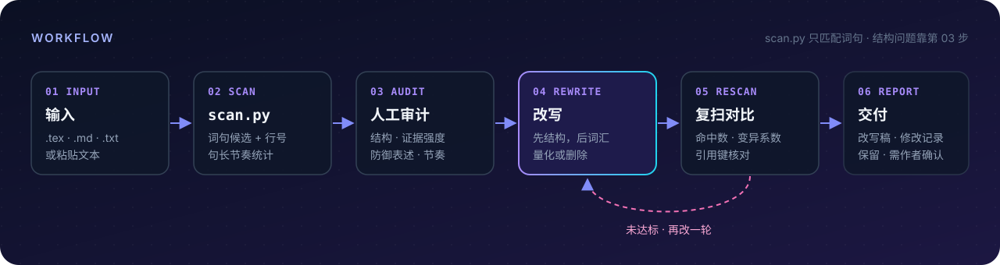

<div align="center">


<br/>

**简体中文** · [English](README.en.md)

[](LICENSE)
[](https://agentskills.io)
[](skills/academic-deai/scripts/scan.py)
[](#-规则库)


[快速开始](#-快速开始) · [效果演示](#-效果演示) · [工作原理](#%EF%B8%8F-工作原理) · [规则库](#-规则库) · [扫描器](#-扫描器)

</div>

---

> 删掉「值得注意的是」「综上所述」「may potentially」这类 AI 腔和自我保护式限定，同时**保留**与证据相称的谨慎表述。
> 数值、公式、引用键和术语一个字都不动。

## ✨ 特性

<table>
<tr>
<td width="50%" valign="top">

### 🧹 去 AI 腔
模板化开头和收尾、空泛强调、拔高夸大、虚化动词、四字格堆砌、「不是……而是……」、*delve / underscore / pivotal*、em-dash、句长过于均匀。

</td>
<td width="50%" valign="top">

### 🛡️ 去防御性表述
叠加限定（*may potentially*）、无人质疑时的预先辩护、泛泛的「仍需进一步研究」、让步套话、过度谦辞、反复出现的范围声明。

</td>
</tr>
<tr>
<td valign="top">

### ⚖️ 不过度矫正
因果与相关的区分、真实的机制推测、置信区间与 p 值、局限性章节都会保留。把「提示」改成「证明」属于制造过度论断，规则明确禁止。

</td>
<td valign="top">

### 🔒 硬约束
不改数值、公式、`\cite` / `\ref` / `\label` 和 LaTeX 结构；不新增事实；不删减论证。原文没有数值时不编造，列入「需作者确认」。

</td>
</tr>
<tr>
<td valign="top">

### 🔍 零依赖扫描器
`scan.py` 只依赖 Python 标准库，中英文规则同时运行，自动跳过 LaTeX 注释、数学环境和引用键，输出带行号的候选问题和句长节奏统计。

</td>
<td valign="top">

### 🔌 一份 skill，多个 agent
遵循 [Agent Skills](https://agentskills.io) 开放标准。Claude Code 用插件市场安装，其他 agent 用 `npx skills` 或安装脚本。

</td>
</tr>
</table>

## 🎬 效果演示

下面是一篇 LaTeX 论文实验分析中的真实段落，按 skill 的 `rewrite` 模式处理。

```diff
- We compare the best single layer, selected by global validation and read with its
-   per-layer linear probe, against this temporal oracle on the UCF-Crime and XD-Violence
-   datasets.
- All numbers in this analysis are measured with the per-layer probe, which is the
-   diagnostic protocol of this section; the deployed pipeline studied in
-   Section~\ref{sec:experiments} reads the same layers through the temporal scorer and
-   therefore yields different absolute values.
- As shown in Table~\ref{tab:preliminary_gap}, the temporal oracle consistently
-   outperforms the static best layer, with a notable improvement on XD-Violence.
- This gap indicates that static single-layer selection may leave substantial headroom
-   when temporal variation in layer preference is not considered.
- In other words, the performance gap suggests that the limitation lies in the static
-   reading strategy, rather than in the absence of useful anomaly-related features within
-   the model.

+ We compare the best single layer, selected by global validation, against the temporal
+   oracle on UCF-Crime and XD-Violence, reading both through the same per-layer linear
+   probes.
+ These probe-based numbers are diagnostic; the deployed pipeline in
+   Section~\ref{sec:experiments} reads the same layers through the temporal scorer, so its
+   absolute values differ.
+ As shown in Table~\ref{tab:preliminary_gap}, the oracle exceeds the static best layer by
+   15.93 AUC on UCF-Crime and 23.66 AP on XD-Violence.
+ Both read the same frozen features.
+ The gap therefore suggests that the bottleneck is the static reading strategy, not a
+   lack of anomaly-relevant features in the model.
```

| 指标 | 改前 | 改后 |
|---|:---:|:---:|
| 词数 | 133 | **97**（−27%） |
| 限定词 | indicates + may + suggests | **suggests** |
| 没有数值的程度词 | consistently · notable · substantial | **0** |
| 超过 30 词的长句 | 1 | **0** |
| 句长变异系数（越低越均匀） | 0.27 | **0.36** |
| `\ref` 键 | 2 | **2**（未变） |

<details>
<summary><b>📋 展开修改记录：改了什么、为什么改</b></summary>

<br/>

| # | 类型 | 改动 | 理由 |
|---|---|---|---|
| 1 | 程度词无量化 | *consistently outperforms … notable improvement* → *exceeds … by 15.93 AUC and 23.66 AP* | 同文表格里已有差值，直接写出来 |
| 2 | 叠加限定 | 删除 *indicates that … may leave substantial headroom* | 上界是实测值，*may* 与 *substantial* 多余；整句与上一句重复 |
| 3 | 重述套话 | *In other words, …* → *… therefore …* | 换个说法再讲一遍不增加信息；*therefore* 表达真实的推理关系 |
| 4 | 补全论证 | 新增短句 *Both read the same frozen features.* | 推断依赖的前提原文没写出来；补成短句后句长也有了变化 |
| 5 | 冗余 | 口径说明从 39 词压缩到 27 词 | 信息完整保留 |

**保留未改**

- **suggests**：oracle 逐帧使用真实标签挑选最优层，上界偏乐观，「瓶颈在读取策略」是推断而不是直接测量，动词强度应停在 *suggests*。
- **not a lack of …**：「特征本身不行」是审稿人一定会提的另一种解释，前一句给出了排除它的依据，这个对比有实际作用。

**需作者确认**

- 同样的口径说明在实验章节又出现了一次，建议只保留一处。

</details>

---

下面是一篇 LaTeX 射频指纹识别论文实验段的真实段落（来自 rewrite\_mzp\_paper），演示 **D10 预先否定 + A12 不利结果处理**两条规则同时触发的情形。

```diff
- LoRa-3-1 进一步把时间跨度扩展到近20个月。图~\ref{fig:dil_results}(b) 与
-   表~\ref{tab:lora10_domains} 显示，所有方法在 D2 均出现累计测试准确率下降。
-   DistMix 由 D1 的95.05\%降至 D2 的83.05\%，随后在 D3--D8 恢复至
-   88.27\%--94.96\%，D9 和 D10 分别为91.43\%和89.75\%。与 TFMix 相比，
-   DistMix 在 D2--D10 的每个阶段均取得更高准确率。不过，D6 的 MMD 为
-   90.52\%，略高于 DistMix 的90.45\%，因此不能将总体优势表述为每一阶段都
-   优于所有对照。DistMix 的十阶段算术平均为90.70\%，与 D10 的89.75\%分别
-   描述整条轨迹和最终累计测试状态。

+ LoRa-3-1 进一步把时间跨度扩展到近20个月。图~\ref{fig:dil_results}(b) 与
+   表~\ref{tab:lora10_domains} 显示，所有方法在 D2 均出现累计测试准确率下降。
+   DistMix 由 D1 的95.05\%降至 D2 的83.05\%，随后在 D3--D8 恢复至
+   88.27\%--94.96\%，D9 和 D10 分别为91.43\%和89.75\%。与 TFMix 相比，
+   DistMix 在 D2--D10 的每个阶段均取得更高准确率。D6 阶段，MMD 与 DistMix
+   的准确率分别为90.52\%和90.45\%。DistMix 的十阶段平均准确率为90.70\%，
+   最终阶段准确率为89.75\%，体现了其在长期时间域序列中的持续适应能力。
```

| 指标 | 改前 | 改后 |
|---|:---:|:---:|
| 字数 | 148 | **138**（−7%） |
| `\ref` 键 | 2 | **2**（未变） |
| 数值 | 全部保留 | **全部保留** |
| 预先否定句（D10）| 1（"因此不能……"） | **0** |
| 叠加描述句（A12）| 1（"分别描述……"） | **0** |

<details>
<summary><b>📋 展开修改记录：改了什么、为什么改</b></summary>

<br/>

| # | 规则 | 改动 | 理由 |
|---|---|---|---|
| 1 | D10 预先否定 | 删除"不过，D6 的 MMD……因此不能将总体优势表述为……" | 没有人提出这个推论；删掉这句，D6 的差值作为独立事实在下一句陈述即可 |
| 2 | A12 不利结果 | "D6 的 MMD 为90.52%，略高于 DistMix 的90.45%" 独立成句，直接并列陈述 | 例外不被隐藏，但不再充当否定整体结论的依据 |
| 3 | A12 叠加描述 | "与 D10 的89.75%分别描述整条轨迹和最终累计测试状态" → 改写为结论句 | 原句只是重复说明口径，删掉说明，换成有实质内容的结论 |

**保留未改**

- 所有阶段数值（95.05%、83.05%、90.52%、90.45%、90.70%、89.75%）完整保留
- 两个 `\ref` 键（`fig:dil_results`、`tab:lora10_domains`）未变
- D2 的普遍下降描述保留：这是真实观测，不是防御性说明

</details>

## 🚀 快速开始

### 方式一：Claude Code 插件市场

```bash
claude plugin marketplace add LinYeeGiong/academic-deai
claude plugin install academic-deai@academic-deai
```

> 在会话中也可以用 `/plugin marketplace add …` 和 `/plugin install …`。更新：`claude plugin marketplace update academic-deai`。

### 方式二：npx（任意 agent，需要 Node.js）

```bash
npx skills add LinYeeGiong/academic-deai                                # 交互选择 agent
npx skills add LinYeeGiong/academic-deai -g -a codex -a pi -a claude-code -y
```

| 选项 | 作用 |
|---|---|
| `-g` | 装到用户目录（不加则装到当前项目） |
| `-a <agent>` | 指定 agent：`claude-code`、`codex`、`pi`、`cursor`、`gemini-cli`、`opencode`、`goose` …… |
| `--copy` | 复制文件（默认软链接） |
| `-y` | 跳过确认 |

更新或卸载：`npx skills update`、`npx skills remove academic-deai`。

### 方式三：安装脚本（不需要 Node.js）

```bash
git clone https://github.com/LinYeeGiong/academic-deai.git && cd academic-deai
sh install.sh          # macOS / Linux / Git Bash / WSL
.\install.ps1          # Windows PowerShell
```

脚本总会装到跨 agent 通用位置 `~/.agents/skills/`，并为本机已配置的 agent 各装一份。`--list` 只预览，`--link` 用软链接（之后 `git pull` 即可更新），`--project` 装进当前项目。

<details>
<summary><b>📁 手动安装：各 agent 的 skills 目录</b></summary>

<br/>

把 `skills/academic-deai/` 整个目录复制过去即可。

| Agent | 用户级目录 | 项目级目录 | 调用方式 |
|---|---|---|---|
| Claude Code | `~/.claude/skills/` | `.claude/skills/` | `/academic-deai` |
| Codex | `~/.agents/skills/` | `.agents/skills/` | `$academic-deai` |
| pi | `~/.agents/skills/` | `.agents/skills/` | `/skill:academic-deai` |
| Cursor \* | `~/.cursor/skills/` | `.cursor/skills/` | 直接描述需求 |
| Gemini CLI \* | `~/.gemini/skills/` | `.gemini/skills/` | 直接描述需求 |
| OpenCode \* | `~/.config/opencode/skills/` | `.opencode/skills/` | 直接描述需求 |
| Goose \* | `~/.config/goose/skills/` | `.goose/skills/` | 直接描述需求 |

\* 按各 agent 的公开约定填写，未逐一实测。不确定时优先用 `~/.agents/skills/`，这是 Agent Skills 标准的跨 agent 位置。

</details>

## 💬 使用

直接描述需求，agent 会根据 skill 描述自动加载：

```text
帮我把 paper/main.tex 第 120–260 行去AI化，去掉防御性表述
De-AI the abstract in draft.md and remove defensive hedging
```

| 模式 | 行为 |
|---|---|
| `audit` | 只列问题清单 |
| `rewrite`（默认） | 输出改写稿、修改记录、保留未改说明和需作者确认清单，不动源文件 |
| `apply` | 改写后写回源文件，需要明确要求 |

## ⚙️ 工作原理



扫描器只能匹配词句，段落模板化、论断与证据是否匹配、同指异名等结构性问题要靠人工审计这一步。

## 📚 规则库

| 文件 | 内容 |
|---|---|
| [`zh_patterns.md`](skills/academic-deai/references/zh_patterns.md) | 中文 AI 腔：词汇层 9 类、句式层 7 类、段落层 4 类，附改写前后示例 |
| [`en_patterns.md`](skills/academic-deai/references/en_patterns.md) | English AI tells: vocabulary, sentence patterns, paragraph-level, with before/after examples |
| [`defensive_hedging.md`](skills/academic-deai/references/defensive_hedging.md) | 防御性表述 11 类（D1–D11）、证据强度与措辞对照表、**必须保留的谨慎表述** |

## 🔍 扫描器

```bash
python skills/academic-deai/scripts/scan.py draft.tex --format md
python skills/academic-deai/scripts/scan.py draft.tex --lines 120-260 --format text
```

<details>
<summary><b>扫描器细节</b></summary>

<br/>

- Python 3.9+，只用标准库。
- 中英文规则同时运行，句长统计按语言分别计算：均值、变异系数（低于 0.35 视为偏均匀）、句首连接词比例。
- `.tex` 自动跳过注释、`$…$`、`\cite` / `\ref` / `\label` 键，以及 `equation`、`align`、`table`、`figure`、`algorithm` 等环境。
- 命中项只是**候选**：带统计检验的「显著」、表达真实不确定性的「可能」都应保留。
- 自测：`python skills/academic-deai/scripts/scan.py skills/academic-deai/scripts/_selftest.tex --format text`

</details>

<details>
<summary><b>🗂️ 仓库结构</b></summary>

<br/>

```text
academic-deai/
├── .claude-plugin/
│   ├── marketplace.json        # Claude Code 插件市场清单
│   └── plugin.json             # 插件清单
├── skills/academic-deai/       # skill 本体，所有 agent 共用
│   ├── SKILL.md
│   ├── references/             # 规则库
│   └── scripts/                # 扫描器与自测样例
├── assets/                     # 横幅与流程图
├── install.sh                  # macOS / Linux / Git Bash
├── install.ps1                 # Windows PowerShell
└── LICENSE
```

</details>

## ⚠️ 声明

本 skill 用于提升学术文本的可读性和表达质量，**不用于规避**期刊、学校或资助机构对 AI 使用的披露要求。请遵守所在机构和投稿目标的政策。

## 📄 License

[MIT](LICENSE) © LinYeeGiong

<div align="center">
<br/>
<sub>如果它帮你改好了一段论文，欢迎点个 ⭐</sub>
</div>
